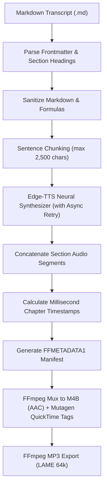

<p align="center">
  
</p>

# Skald 🎙️

> Arctic Oral Companion & Multi-Chapter M4B Audiobook Compiler

Skald is a Frost-native neural speech synthesizer, oral companion compiler, and audiobook packager. Named after the Old Norse bards who recited epic sagas, histories, and technical lore across frozen polar nights, Skald converts written transcripts, lecture notes, and markdown course companions into high-fidelity, chapter-indexed M4B audiobooks and MP3 audio series.

[](https://spanishsyntax.github.io/Skald)
[](LICENSE)

---

## Why "Skald"? (The Lore)

> **skald** (`/skɑːld/`) — *noun:* An ancient Norse poet, scholar, and oral historian who recited complex sagas, tactical lineages, and epic poetry by the longhouse hearth during sunless polar winters.

In arctic cultures before the written word, complex technical knowledge, navigational routes, and ancestral histories were preserved entirely through spoken storytelling—recited with cadence, rhythm, and dramatization so they would never be forgotten.

Skald transforms dense manuscripts into spoken sagas:
- **The Oral Companion**: Converts technical readers, lecture notes, and textbook chapters into natural, multi-voice spoken audiobooks with sentence-level neural TTS.
- **Chapter-Indexed M4B**: Compiles complete lecture series into publication-grade, chapter-marked M4B audiobooks ready for offline listening on any device.

---

## Features

- **Conversational Transcript Ingestion**: Parses markdown transcripts with frontmatter metadata (`title`, `author`, `album`) and automatic section/heading splitting.
- **Sentence-Level Neural Chunking**: Splits narrative text at sentence boundaries with exponential retry backoff and timeout recovery.
- **True QuickTime / MPEG-4 Chapter Markers**: Generates standard `FFMETADATA1` structures with millisecond precision and embeds navigable chapter points directly into `.m4b` containers.
- **Multi-Chapter Master Stitching**: Discovers standalone chapter files, calculates relative timeline offsets, tags metadata/cover art, and compiles the master companion audiobook.
- **Voice Discovery**: Live discovery and filtering of Microsoft Edge-TTS neural voices across locales (`en-US`, `de-DE`, etc.) and voice profiles.
- **Audiobook Inspector**: Inspects durations, bitrates, tags, and chapter markers in a clean terminal panel.
- **Model Context Protocol (MCP)**: Native stdio server exposing audiobook narration, voice queries, and metadata inspection tools to AI agents.

---

## Documentation

Full documentation, architecture diagrams, CLI recipes, and API references are available on the **[Documentation Site](https://spanishsyntax.github.io/Skald)**:

- [Getting Started](https://spanishsyntax.github.io/Skald/#/getting-started)
- [Architecture & Pipeline](https://spanishsyntax.github.io/Skald/#/architecture)
- [CLI Reference & Recipes](https://spanishsyntax.github.io/Skald/#/usage)
- [Configuration & API Reference](https://spanishsyntax.github.io/Skald/#/api)

---

## Quick Start

### 1. Synthesize a Markdown Transcript

```bash
# Narrate a single chapter transcript
skald narrate transcripts/ch01_foundations.md

# Specify custom neural voice and speech rate
skald narrate transcripts/ch01_foundations.md --voice en-US-GuyNeural --rate "+5%" -o ./dist
```

### 2. Stitch Multiple Chapters into a Master Audiobook

```bash
# Scan a directory of chapter audio files and stitch into master audiobook
skald stitch ./audio/chapters/ \
  --output ./audio/Master_Companion.m4b \
  --title "Distributed Systems Companion" \
  --author "Systems Architecture Group" \
  --album "Technical Audio Companions" \
  --cover ./cover.png \
  --mp3
```

### 3. Discover Neural Voices

```bash
# List top recommended voices
skald voices

# Filter by locale and gender
skald voices --locale en-US --gender Male
```

### 4. Inspect an Audiobook

```bash
skald inspect ./audio/Master_Companion.m4b
```

---

## Pipeline Architecture



---

## CLI Overview

```text
usage: skald [-h] [-V] [--color {auto,always,never}] [--no-color] {narrate,recite,stitch,voices,inspect,mcp} ...

Arctic oral companion & multi-chapter M4B audiobook compiler.

subcommands:
  narrate (recite)   Synthesize a markdown transcript into M4B & MP3
  stitch             Stitch multiple chapters into a master M4B audiobook
  voices             Query and list available neural voices
  inspect            Inspect M4B metadata and chapters
  mcp                Run Model Context Protocol stdio server
```

---

## Nix Flake & Home Manager Configuration

Add Skald to your flake inputs:

```nix
{
  inputs = {
    nixpkgs.url = "github:nixos/nixpkgs/nixos-unstable";
    skald.url = "github:SpanishSyntax/Skald";
    skald.inputs.nixpkgs.follows = "nixpkgs";
  };
}
```

### Home Manager Module

```nix
{
  programs.skald = {
    enable = true;
  };
}
```

---

## License

MIT © [SpanishSyntax](https://github.com/SpanishSyntax)
