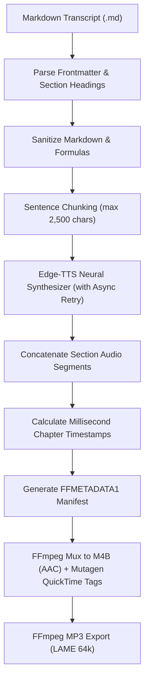

  

# Skald 🎙️

> Arctic Oral Companion & Multi-Chapter M4B Audiobook Compiler

Skald is a Frost-native neural speech synthesizer, oral companion compiler, and audiobook packager. Named after the Old Norse bards who recited epic sagas, histories, and technical lore across frozen polar nights, Skald transforms written transcripts, lecture notes, and markdown course companions into high-fidelity, chapter-indexed M4B audiobooks and MP3 audio series.

---

## Why "Skald"? (The Lore)

> **skald** (`/skɑːld/`) — *noun:* An ancient Norse poet, scholar, and oral historian who recited complex sagas, tactical lineages, and epic poetry by the longhouse hearth during sunless polar winters.

In arctic cultures before the written word, complex technical knowledge, navigational routes, and ancestral histories were preserved entirely through spoken storytelling—recited with cadence, rhythm, and dramatization so they would never be forgotten.

Skald transforms dense manuscripts into spoken sagas:
- **The Oral Companion**: Converts technical readers, lecture notes, and textbook chapters into natural spoken audiobooks with sentence-level neural TTS.
- **Chapter-Indexed M4B**: Compiles complete lecture series into publication-grade, chapter-marked M4B audiobooks ready for offline listening on any modern audio player.

---

## Core Features

- **Conversational Transcript Ingestion**: Parses Markdown transcripts with frontmatter metadata (`title`, `author`, `album`) and automatic heading-based section segmentation.
- **Sentence-Level Neural Chunking**: Splits dense narrative text cleanly at sentence boundaries (avoiding the ~3,500 character payload limits of cloud TTS endpoints) with exponential retry backoff and timeout recovery.
- **QuickTime / MPEG-4 Chapter Markers**: Generates standard `FFMETADATA1` structures with millisecond precision and embeds navigable chapter points directly into `.m4b` containers.
- **Multi-Chapter Master Stitching**: Discovers standalone chapter audio files, computes relative timeline offsets, embeds cover art and album tags, and outputs master companion audiobooks.
- **Voice Discovery**: Live querying and filtering of Microsoft Edge-TTS neural voices across languages, locales (`en-US`, `de-DE`, etc.), and voice profiles.
- **Audiobook Inspection**: Detailed terminal inspect dashboard displaying stream bitrates, sample rates, metadata tags, and chapter offsets.
- **Model Context Protocol (MCP)**: Native stdio server exposing audiobook narration, voice queries, and metadata inspection tools to AI agents.

---

## Pipeline Flow

---

## Quick Navigation

- [Getting Started](getting-started.md): Installation options via Nix Flakes or pip, ffmpeg prerequisites, and first synthesis.
- [Architecture & Pipeline](architecture.md): Deep-dive into chunking algorithms, retry backoffs, and container muxing.
- [CLI Reference & Recipes](usage.md): Syntax and usage examples for `narrate`, `stitch`, `voices`, and `inspect`.
- [Configuration & API Reference](api.md): Frontmatter specification, Python API reference, and Nix module integration.
