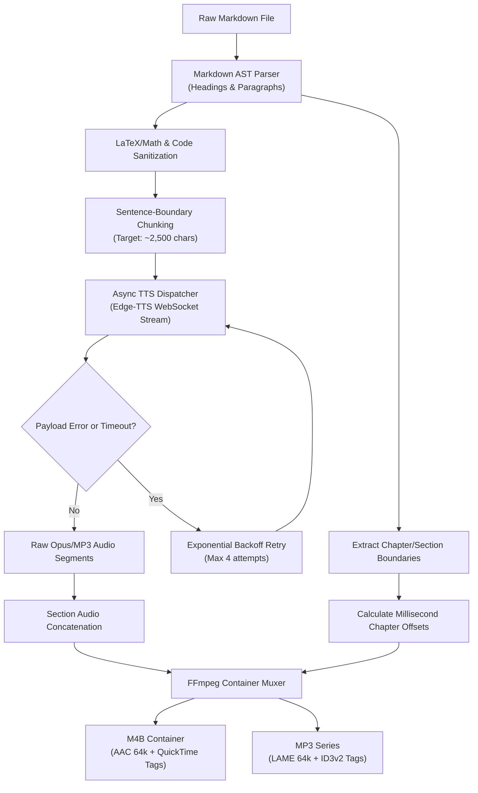
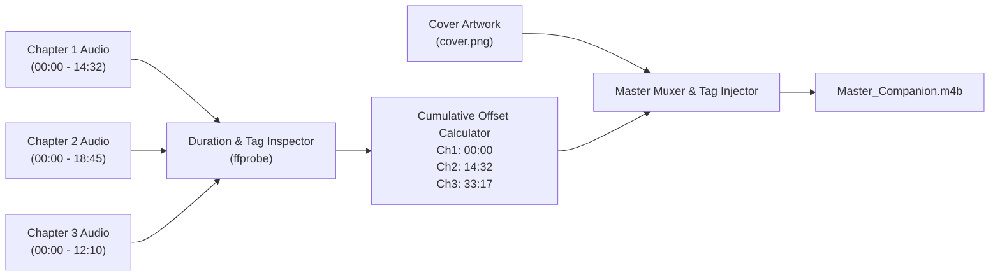

# Architecture & Pipeline

Skald combines text parsing, async neural speech synthesis, and media container muxing into a unified compilation pipeline.

---

## Synthesis Engine

The synthesis engine processes structured Markdown into segmented audio units, preserving natural paragraph cadences while satisfying cloud endpoint payload constraints.



---

## Sentence Chunking and Backoff

Public Edge-TTS endpoints drop connections or reject payloads when individual synthesis requests exceed approximately 3,500 characters.

Skald implements a sentence-level chunker (`skald.synthesizer`):
1. **Punctuation Boundaries**: Text is split on primary sentence terminators (`. `, `? `, `! `), followed by secondary delimiters (`; `, `—`) if a single sentence exceeds the maximum chunk length.
2. **Chunk Sizing**: Chunks are bundled up to a safe threshold (2,500 characters), ensuring that natural prosody is maintained across sentence transitions.
3. **Exponential Backoff**: Transient network dropouts or WebSocket timeouts trigger jittered exponential backoffs (1s, 2s, 4s, 8s), preventing batch pipeline failures midway through lengthy audiobooks.

---

## FFMETADATA1 Chapter Indexing

To produce fully navigable audiobooks that work on Apple Books, VLC, Voice, and Smart AudioBook Player, Skald generates standard QuickTime / MPEG-4 chapter manifests conforming to the `FFMETADATA1` format:

```text
;FFMETADATA1
title=Distributed Consensus Foundations
artist=Alex Rivera
album=Autonomous Systems Companion

[CHAPTER]
TIMEBASE=1/1000
START=0
END=45230
title=Introduction to Consensus

[CHAPTER]
TIMEBASE=1/1000
START=45230
END=182450
title=Synchronous vs Asynchronous Networks
```

During the muxing stage, FFmpeg merges the audio stream and metadata file in a single pass:

```bash
ffmpeg -i concat_audio.aac -i metadata.txt -map_metadata 1 -c copy output.m4b
```

---

## Multi-Chapter Stitching

When compiling an entire course companion or textbook series, individual chapters can be narrated in parallel worker jobs. The stitching subsystem (`skald stitch`) aggregates these standalone audio files into a unified master volume:



1. **Duration Probing**: `ffprobe` extracts exact microsecond durations from each audio segment.
2. **Timeline Cumulative Offsets**: Skald calculates sequential chapter intervals and writes the unified master manifest.
3. **Lossless Transcoding**: Pre-encoded AAC streams are concatenated losslessly without re-encoding degradation whenever source codecs align.

---

## Container Layout

### M4B Container (MPEG-4 Part 14)
- **Audio Stream**: AAC-LC encoded at 64 kbps (mono or stereo), providing speech fidelity at compact file sizes (~28 MB per hour of audio).
- **Metadata Atom**: `moov.udta.meta.ilst` containing QuickTime tags (`©nam`, `©ART`, `©alb`, `©day`, `covr`).
- **Chapter Track**: Standard MPEG-4 text chapter atom referencing the synchronized timeline.

### MP3 Container (ID3v2)
- **Audio Stream**: MPEG-1 Audio Layer III via LAME encoder at 64 kbps constant bitrate.
- **Metadata**: ID3v2.3 tags with embedded cover art and chapter frames (`CHAP`).
